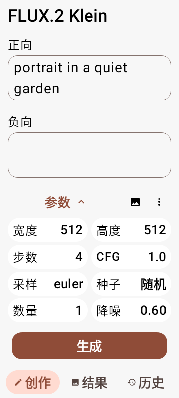
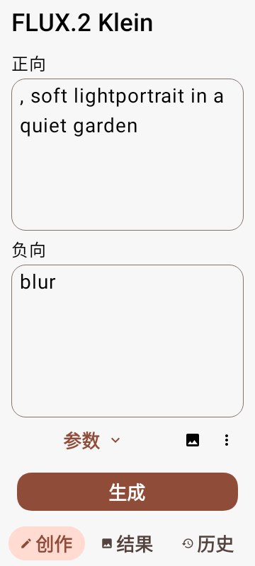
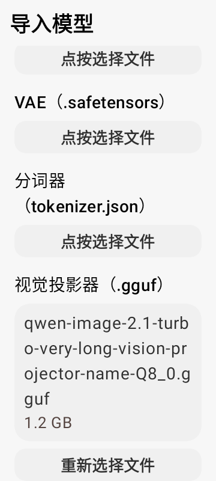
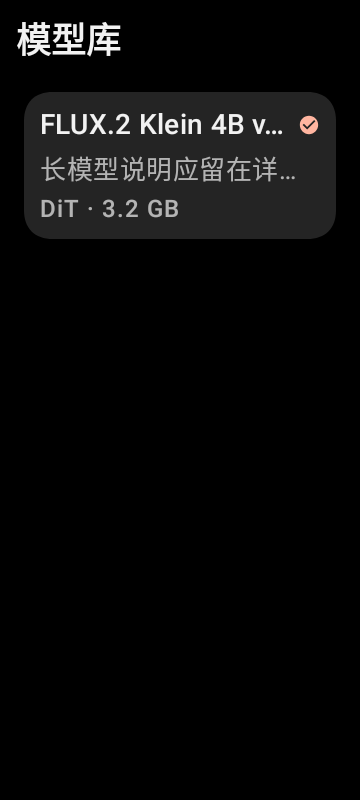

# SM8650 v0.11：Miuix 界面重构

使用官方 [Miuix 0.9.0](https://github.com/compose-miuix-ui/miuix) 的主题、文字、按钮、图标按钮、卡片、文本框、开关、滑块、导航栏及 Scaffold。Material 组件与自定义编辑器通过颜色桥接保持一致；原有主题选择、动态取色和深浅模式继续生效。许可证随 APK 的 `assets/licenses/Miuix.txt` 提供。

## 页面与操作

- 模型库：简洁标题栏、格式分类、紧凑模型卡。名称和简介限制行数，下载状态不再覆盖名称。完整说明在创作页按需展开。
- 创作：固定一屏布局，无页面滚动。正向和负向提示词直接上下显示在同一页；下方参数网格可展开/收起。收起参数后，两个输入框得到更多空间。图片与参数值在同页上方临时编辑，关闭编辑返回两个提示词，生成/中断操作固定在底部。创作、结果、记录使用 Miuix 主题的紧凑底栏，避免拖动输入框时误翻页。
- 参数：宽、高、步数、CFG、采样器、种子、数量、降噪、适用的运算设备与比例都在生成页。点击参数格子，在同页上方编辑，完成后返回提示词，不打开参数页面。保留原尺寸范围、固定画布规则、采样器与 Karras、运行时选择，以及更多菜单中的参数导入/分享/重置。
- 结果：保存、收藏、放大、UltraFix 与图片导入改为独立短操作，宽度不足时分行排列；导入图片入口无需长按发现。保留图片预览、参数详情、近期图片和历史记录。
- 设置：主页三个点进入独立导航目的地。长说明通过信息按钮展开，开关行保持紧凑。CPU 解码继续使用原有偏好值，默认 DSP。
- 导入：DiT、SD checkpoint 转换、QNN 压缩包均为独立完整页面。DiT 按家族、组件、名称三步进行，需要视觉投影器的家族单独列出该文件。长文件名显示在按钮外；旋转时保留 DiT 已选文件。SD 转换保留 Clip Skip 和既有 LoRA 融合选项。
- 导入重名保护：checkpoint/压缩包导入同时验证名称、保留 ID、已有目录。底层转换/解包只清理本次创建的目录，拒绝覆盖已有模型。

## 大字体原则

遵循用户系统字体，不降低全局字体缩放。操作按钮使用单行短名称，通用操作默认高度至少 52dp，生成页参数格子最小 48dp；可用宽度不足时省略操作名称末尾，长说明在控件外阅读。按钮内文字不换行堆高；菜单与可点击图标保留内容描述。长文件名和展开的说明可以正常换行。导入、设置等列表页可以滚动，生成页保持固定布局。

提示词按可用空间分配固定行数，较长内容在输入框内查看，不把生成页撑高。展开/收起参数后重新分配编辑空间，保留两个提示词内容和选择。键盘弹出时暂时隐藏顶部标题与底部导航，为输入留出空间。输入法组合、文本选择、光标位置、标签联想与撤销/重做仍由原提示词控制器处理。键盘避让和底部操作区分别处理，不在底部导航上重复添加系统导航栏间距。

## 验证范围

58 项单元/界面测试通过，ktlint 与 detekt 通过。使用 Robolectric Android 15 原生图形后端，对 360dp 宽度、1.0/1.3/1.5/2.0 倍字体执行实际 Compose 布局测试。检查按钮单行和高度、开关行高度、说明展开、家族选择、视觉投影器文件选择、提示词输入、一屏参数可见性/原位编辑/确认和保存操作，导出 Activity 视图截图供人工查看。

这类测试验证页面显示与操作回调，不能代替小米 14 实机的输入法、系统文件选择器和推理测试。本次未修改 DSP/CPU 数学计算与模型格式；现有模型无需重新下载。

安装包仍使用独立应用 ID `io.github.xororz.localdream.sm8650` 和原调试证书，versionCode 84、版本 `3.0.0-alpha.8.0-sm8650`，用于覆盖安装前版。

## 2 倍字体截图

以下为 360dp 宽度、2 倍字体的真实 Android 视图渲染。

 

 
