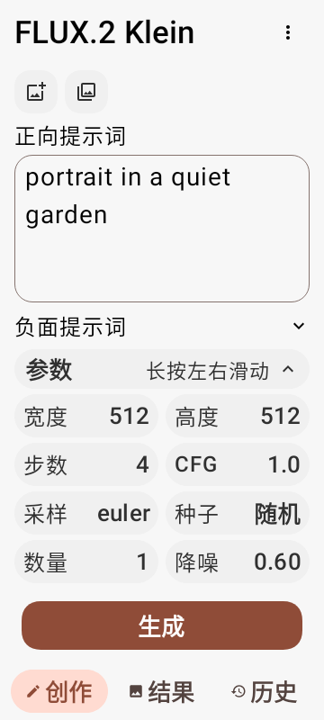
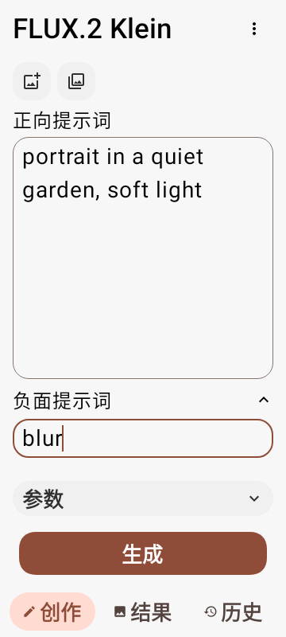
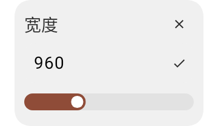
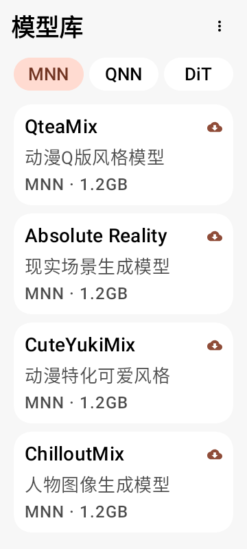

# SM8650 v0.12：生成交互与滚动修复

## 本轮修改

- 图片输入移到正向提示词上方，使用带用途说明的图标按钮，取消文字按钮和下方参数栏的图片按钮。
- 更多菜单移到顶部模型名称右侧，在创作、结果和记录页均可使用。
- 提示词获得焦点或键盘显示时自动收起参数。点击参数标题可结束输入并展开，内容和参数值继续保留。
- 负面提示词为参数面板之外的独立区域，放在正向提示词下方、参数面板上方，使用独立标题和展开箭头，不加分隔线，默认收起。展开后的编辑区为 72dp，长文本在输入框内查看，不再与正向提示词平均占用空间。
- 参数普通点按打开独立小卡片，保留提示词页面；支持数值输入、滑块、种子和原有选项。
- 参数长按后左右拖动，每移动约 12dp 调整一档。数值保持原有步长和上下限，选项参数按可用选项切换，GPU 选择继续走原有确认流程。拖动结束不会额外触发点按弹窗。
- 模型列表恢复手指滚动，顶部 MNN/QNN/DiT 三个按钮等宽填满可用区域，保留两侧统一边距。
- 主页菜单锚定到右上角按钮，修复弹到左上角的问题。
- 结果页恢复滚动，底部增加留白，完整参数文字可以滑动到导航栏上方查看。

## 滚动问题的原因

v0.11 替换了可折叠标题栏，却留下了 Material 可折叠标题栏的滚动连接。固定标题栏没有更新折叠范围，旧连接持续消耗拖动距离，导致模型列表和结果页无法正常滚动。本版移除这些旧连接，让各页滚动容器处理拖动。生成页面仍保持固定布局。

菜单则需要让按钮与弹出内容处于同一个局部容器，才能使用按钮所在位置作为锚点。

## 验证

82 项单元/界面回归通过；最后移除分隔线后，额外完成 8 项受影响的布局和输入复测。ktlint、detekt 通过。测试在 Android 15 原生图形环境中覆盖 360dp 宽度、1.0/1.3/1.5/2.0 字体缩放，包括独立弹窗的实际系统字体配置。

使用真实触摸输入验证长按拖动、模型列表滑动到实际末项、结果页滚动查看完整参数；同时验证菜单与右上角按钮对齐、模型分类按钮宽度、图片入口位置、输入时自动收起和负面提示词内容保留。

这些测试不执行模型推理，也不能替代小米 14 实机输入法和系统窗口行为的复测。本次不改变模型文件与推理计算。

安装包使用原应用 ID `io.github.xororz.localdream.sm8650` 和原签名证书，versionCode 85，版本 `3.0.0-alpha.8.1-sm8650`，可覆盖 v0.11。

## 大字体截图

 

 
