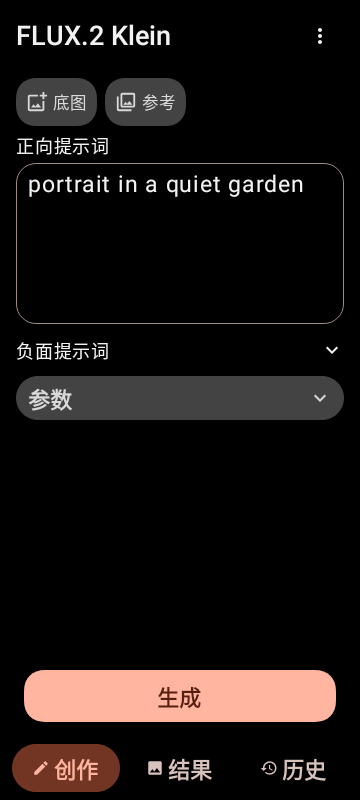
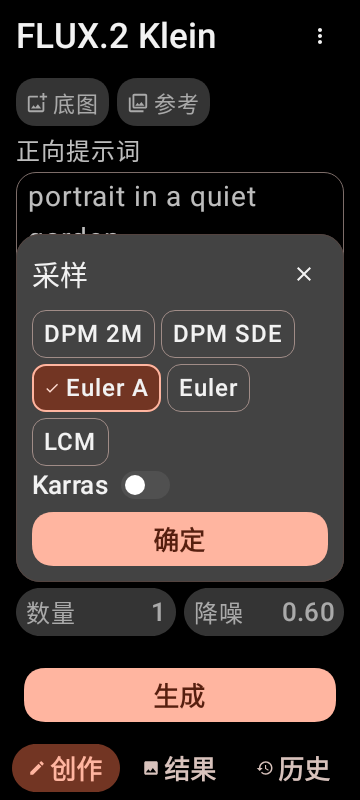
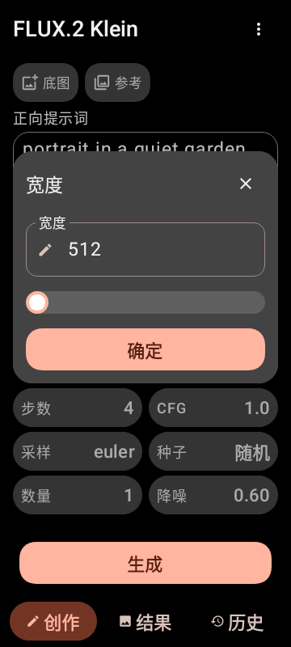
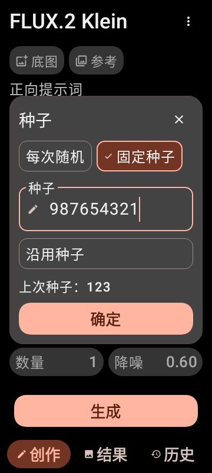
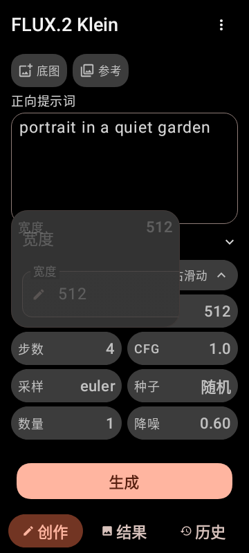
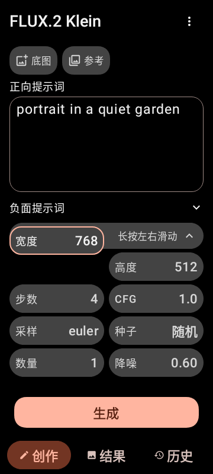

# SM8650 v0.13：可辨识的参数控件与原位展开

## 生成页

- 图片入口保留图标，并添加小号“底图 / 参考”说明。选中图片后，绘制与蒙版也归到同一排带文字说明的工具；缩略图旁不再重复放添加参考图与蒙版按钮。
- 正向提示词区域限制最大高度；负面提示词紧接实际正向输入框下方，位于参数上方，不增加横线。负面输入默认收起，展开高度仍为 72dp。
- 页面本身保持固定布局。输入提示词时自动收起参数；长提示词在输入框内查看，图片工具与缩略图可横向滑动。

## 参数编辑

- 点按参数后，原按钮的四条边在当前页面内扩展为卡片，关闭时沿反方向缩回。卡片高度按实际内容收紧，不再创建独立 Dialog。
- 长按参数后左右滑动调节，名称与当前值抬到手指上方，并加描边与阴影；松手不会误开编辑卡片。同一次拖动按起点累计，连续移动不会漏掉数值变化。
- 采样算法等选项使用明确的填充、边框和勾选标记。数值使用带标签、框线、底色和编辑图标的输入框，完成操作使用文字按钮。
- 种子分为“每次随机 / 固定种子”。随机模式没有多余的空输入框；固定模式显示数值输入。清空后可继续输入，不会自动跳回随机模式；空值确认时使用 0。沿用上次种子有独立边框按钮和带说明的数值。
- 保留原有数值范围、分辨率步长、GPU 选择流程与推理回调。卡片内容在大字体或键盘占用空间时可内部滚动，生成页仍不滚动。

## 验证与安装

106 项检查全部通过，ktlint、detekt 通过。在 Android 15 的 Robolectric 原生图形环境中检查 360dp 宽度，字体缩放为 1.0 / 1.3 / 1.5 / 2.0。测试覆盖控件点击、种子两种模式与清空输入、图片工具单行与回调、负面提示词位置、长按抬起和数值变化、卡片展开中间帧与反向收起，包括处理器选项往返拖动恢复原值，另保留模型列表触摸滚动、菜单位置与结果文字回归。

这些检查不能替代小米 14 的实机输入法与动画复测；此次验证不执行模型推理。

使用原应用 ID 和原证书，versionCode 86，版本 `3.0.0-alpha.8.2-sm8650`，可覆盖 v0.12。发布前在本地验证 APK 签名、对齐、ZIP 完整性与原生库一致性；发布后只读取 GitHub 元数据，不回下载文件。

## 大字体预览

 

 

 
